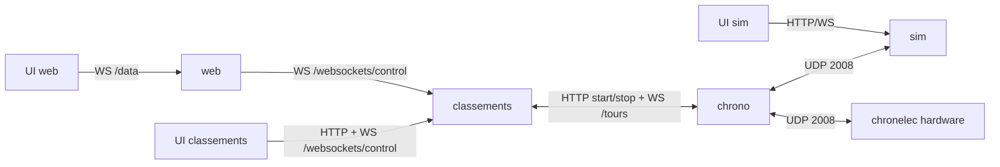
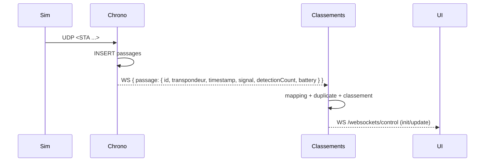

# EnduChrono — Architecture Technique

## 1. Vue d'ensemble (implémentation actuelle)

EnduChrono est un monorepo avec 4 services Fastify indépendants : `sim`, `chrono`, `classements`, `web`.

Communication observée dans le code :



Notes :
- le boitier chronelec (ou le simulateur `sim`) ne pousse pas des tours a `chrono` en HTTP/WS. Le flux de tours est en UDP via protocole Chronelec.
- `web` fait un role de "proxy live" entre `classements` et son UI publique.

## 2. Services

### 2.1 `sim`

Role : emulateur du boitier Chronelec.

Responsabilites :
- emuler les commandes UDP `START`, `STOP`, `STATUS`, `ACK`, `REPEAT`
- maintenir un temps interne (acceleration via multiplicateur)
- alimenter une file de tours a envoyer

API :
- `GET /status` : etat interne du simulateur
- `POST /tours/add` : ajout de tours (JSON ou `text/plain` multi-lignes)
- `POST /time/multiplier` : vitesse du temps
- `POST /connect`, `POST /disconnect` : simulation de coupure
- `GET /ws` (WebSocket) : flux temps reel du simulateur

### 2.2 `chrono`

Role : acquisition UDP, persistance brute des passages, diffusion temps reel.

Responsabilites :
- communiquer en UDP avec `sim` / boitier
- persister les passages en SQLite (`passages`)
- exposer un flux WebSocket `/tours` (passages, statut chrono, connectivite)
- fermer automatiquement la session active si statut detecte `stop` au demarrage

API :
- `GET /` : healthcheck
- `POST /start` : creation/ouverture DB courante + commande START
- `POST /stop` : commande STOP + fermeture session courante (`current.db`)
- `GET /tours` (WebSocket) : replay (`?from=<id>`) + flux live

Stockage :
- SQLite dans `chrono/data`
- lien symbolique `current.db` vers le fichier de session actif

### 2.3 `classements`

Role : coeur metier (association passages, regles course, classements, corrections).

Responsabilites :
- se connecter au WebSocket de `chrono` avec reprise `?from=last_id`
- convertir chaque passage en `tour`
- associer `transpondeur -> dossard -> equipe`
- detecter doublons et ignorer hors phase de course
- recalculer classement general + categorie
- exposer API HTTP d'administration + WebSocket de diffusion

API principale :
- course : `POST /import`, `POST /course/open`, `POST /course/close`
- statuts : `POST /test/start`, `POST /test/stop`, `POST /course/start`, `POST /course/stop`
- donnees : `GET /equipes`, `GET /equipiers`, `GET /transpondeurs`, `GET /categories`
- modifications : `POST /tour`, `POST /tour/:id`, `DELETE /tour/:id`, `POST /transpondeur`, `POST /equipe/:id`
- live : `GET /websockets/control` (WebSocket, topics filtrables)

Stockage :
- SQLite dans `classements/data`
- chargement en memoire (`equipes`, `equipiers`, `transpondeurs`, `tours`, `categories`)

### 2.4 `web`

Role : facade de diffusion publique simplifiee.

Responsabilites :
- se connecter a `classements` (`/websockets/control`) pour maintenir un cache local (`equipes`, `course`)
- exposer `GET /data` (WebSocket) aux clients web publics
- exposer `GET /input` (WebSocket) pour ingestion externe (chemin alternatif non branche par defaut)

## 3. Flux de donnees

### 3.1 Flux principal d'un tour



### 3.2 Reconnexion / rattrapage

`classements` se reconnecte automatiquement a `chrono` et redemande les tours manques :

```text
ws://chrono:3000/tours?from=<dernier_numero_connu>
```

`chrono` renvoie les passages avec `id > from`, puis continue en live.

## 4. Regles metier implementees

### 4.1 Etats de course

Valeurs persistees : `TEST`, `DEPART`, `COURSE`, `FIN`.

Effets :
- en `TEST` et `DEPART`, un nouveau tour est marque `ignore`
- en `COURSE` et `FIN`, les tours sont traites (avec regles doublons)

### 4.2 Detection de doublons

Règle principale (`DUPLICATE_WINDOW_PERIOD`) :
- pour une equipe, si un tour arrive dans les 2 minutes apres un tour valide precedent, alors `status = duplicate`

Regle complementaire :
- si le dernier tour valide de l'equipe depasse la duree course (`COURSE_DUREE = 6h`) et qu'un tour arrive apres, il est aussi marque doublon.

### 4.3 Classement

La valeur de tri est :

```text
rankValue = -(nb_tours + penalite) * 100 * 3600 * 1000 + temps
```

Donc :
- priorite au nombre de tours (corrige par `penalite`)
- puis departage au meilleur temps (plus petit `temps`)

## 5. Diffusion temps reel

### 5.1 WebSocket `classements` (`/websockets/control`)

Evenements emis :
- `init` (snapshot complet)
- `update` (batch de `tour`, `equipe`, `equipier`, `transpondeur`)
- `course`, `status`, `connection`
- `open`, `close` (via evenements SQL)

### 5.2 WebSocket `web` (`/data`)

Evenements emis :
- `init` (equipes + course)
- `equipe` (mise a jour equipe)
- `course` (si recu via `input`)

## 6. Deploiement Docker

Commandes :
- prod : `docker-compose --profile prod up --build`
- dev : `docker-compose --profile dev up`

Ports exposes (dev) :
- APIs : 3000 (`classements`), 3001 (`chrono`), 3002 (`sim`), 3003 (`web`)
- UIs : 8080 (`classements-ui`), 8081 (`sim-ui`), 8082 (`web-ui`)

Contraintes reseau :
- en conteneur, les services se resolvent via noms Docker (`chrono-dev`, `sim-dev`, etc.)
- ne pas changer host/ports sans synchroniser les variables d'environnement et `docker-compose.yml`
